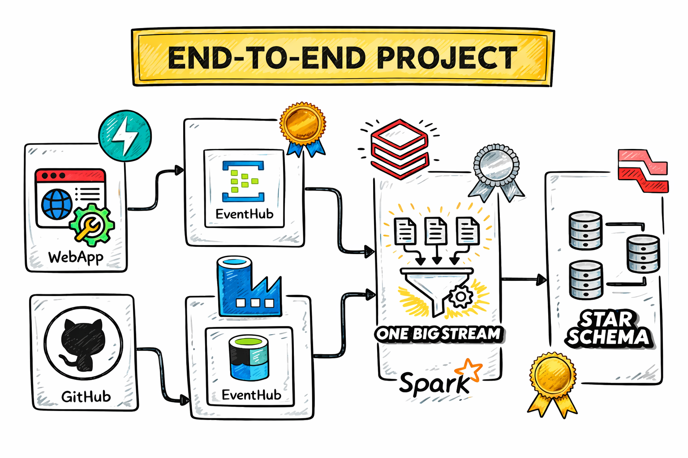
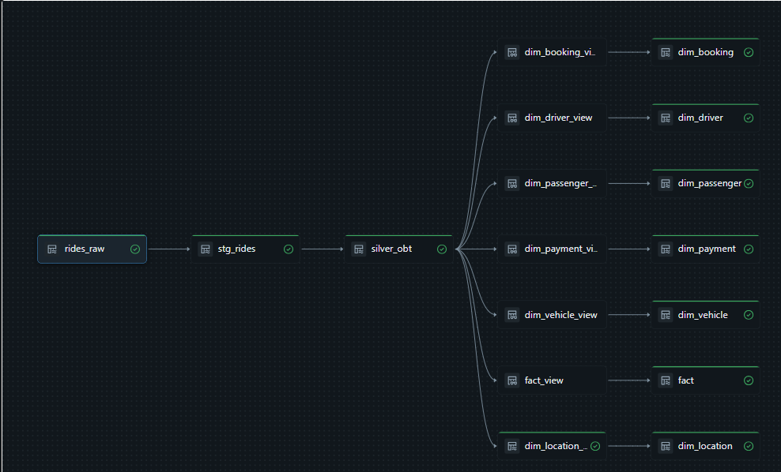

# 🚖 Uber Azure Data Engineering Project

An end-to-end real-time Azure Data Engineering project built using Azure Event Hub, Azure Databricks, Delta Live Tables (DLT), PySpark, FastAPI, and Medallion Architecture.

This project simulates Uber ride booking events, streams them through Azure Event Hub, processes the data using Azure Databricks, and builds fact and dimension tables for analytics.

---

# 📌 Project Architecture



## Architecture Overview

This project implements a real-time end-to-end Azure Data Engineering pipeline for Uber ride analytics.


# 📷 Pipeline Screenshot




### Pipeline Flow

1. FastAPI Web Application generates Uber ride booking events
2. Ride events are pushed into Azure Event Hub
3. Azure Databricks consumes streaming events using Kafka protocol
4. PySpark streaming pipelines process incoming ride data
5. Silver layer performs schema validation and transformations
6. One Big Table (OBT) is created using streaming SQL joins
7. Gold layer builds Star Schema dimensional models
8. Fact and Dimension tables are generated for analytics and reporting
---

# 🏗️ Medallion Architecture

## Bronze Layer
- Raw streaming ingestion
- Event Hub/Kafka data ingestion
- Stores unprocessed ride events

### Files
- `databricks/bronze/ingest.py`

---

## Silver Layer
- Schema enforcement
- JSON parsing
- Data cleansing
- Business transformations
- Streaming joins with mapping tables

### Files
- `databricks/silver/silver.py`
- `databricks/silver/silver_obt.sql`

---

## Gold Layer
- Fact and Dimension modeling
- CDC implementation
- Slowly Changing Dimensions (SCD)
- Analytical tables for reporting

### Files
- `databricks/gold/model.py`

---

# ⚙️ Technologies Used

| Technology | Purpose |
|---|---|
| Azure Event Hub | Real-time event streaming |
| Azure Databricks | Data processing |
| Delta Live Tables | Streaming pipelines |
| PySpark | Transformations |
| FastAPI | Ride event simulation API |
| Kafka API | Event Hub streaming integration |
| Delta Lake | Streaming tables |
| Python | Backend development |
| SQL | Transformations and joins |
| Faker | Synthetic data generation |

---

# 📂 Project Structure

```bash

Uber_Data_Engineer_Project/
│
├── databricks/
│   ├── bronze/
│   │   └── ingest.py
│   │
│   ├── silver/
│   │   ├── silver.py
│   │   └── silver_obt.sql
│   │
│   └── gold/
│       └── model.py
│
├── templates/
│
├── screenshots/
│   ├── architecture.png
│   └── pipeline_flow.png
│
├── api.py
├── connection.py
├── data.py
│
├── requirements.txt
├── README.md
└── .gitignore
```

---

# 🔄 Data Pipeline Flow

## Step 1 — Generate Uber Ride Events
The FastAPI application generates synthetic Uber ride booking events using Faker.

### Features Generated
- Passenger information
- Driver information
- Vehicle details
- Ride fares
- Pickup/drop locations
- Payment methods
- Ride statuses

---

## Step 2 — Push Events to Azure Event Hub
Ride events are serialized into JSON format and pushed into Azure Event Hub.

### Files Responsible
- `api.py`
- `connection.py`
- `data.py`

---

## Step 3 — Bronze Layer Streaming Ingestion
Azure Databricks reads streaming data from Azure Event Hub using Kafka protocol.

### Features
- Real-time ingestion
- Kafka streaming
- Event Hub integration
- Raw data persistence

### File
- `ingest.py`

---

## Step 4 — Silver Layer Transformation
Raw Kafka payloads are parsed into structured schema using PySpark.

### Transformations
- JSON parsing
- Schema enforcement
- Timestamp conversion
- Data standardization

### File
- `silver.py`

---

## Step 5 — Streaming SQL Enrichment
Streaming joins are performed with mapping tables to enrich ride data.

### Enrichments
- Vehicle type
- Payment methods
- Ride statuses
- City mapping
- Cancellation reasons

### File
- `silver_obt.sql`

---

## Step 6 — Gold Layer Modeling
Fact and Dimension tables are created using Delta Live Tables CDC flows.

### Dimension Tables
- dim_passenger
- dim_driver
- dim_vehicle
- dim_payment
- dim_booking
- dim_location

### Fact Table
- fact

### Features
- SCD Type 1
- SCD Type 2
- Streaming CDC pipelines

### File
- `model.py`

---

# 📊 Fact & Dimension Modeling

## Fact Table
Stores ride transaction metrics.

### Measures
- total_fare
- distance_miles
- duration_minutes
- surge_multiplier
- tip_amount

---

## Dimension Tables

### dim_passenger
Passenger details

### dim_driver
Driver information

### dim_vehicle
Vehicle metadata

### dim_payment
Payment methods

### dim_booking
Booking and trip details

### dim_location
City and region hierarchy

---

# 🚀 Running the Project

## 1. Clone Repository

```bash
git clone <your_repo_url>
```

---

## 2. Install Dependencies

```bash
pip install -r requirements.txt
```

---

## 3. Configure Environment Variables

Create `.env`

```env
CONNECTION_STRING=your_eventhub_connection_string
EVENT_HUBNAME=ubertopic
```

---

## 4. Start FastAPI Server

```bash
uvicorn api:app --reload
```

---

## 5. Execute Databricks Pipelines

Run:
- Bronze ingestion pipeline
- Silver transformation pipeline
- Gold modeling pipeline

---

# 📈 Key Features

✅ Real-time streaming architecture  
✅ Azure Event Hub integration  
✅ Kafka streaming with Databricks  
✅ Delta Live Tables (DLT)  
✅ CDC implementation  
✅ SCD Type 1 & Type 2  
✅ Medallion architecture  
✅ Fact & dimension modeling  
✅ PySpark transformations  
✅ Streaming SQL pipelines  

---

# 🔐 Security

Sensitive credentials are managed using:
- Environment variables
- Databricks secrets
- Secure configuration handling

---


# 📌 Future Improvements

- Azure Data Factory orchestration
- Power BI dashboard integration
- CI/CD pipeline deployment
- Monitoring & alerting
- Unity Catalog integration

---
